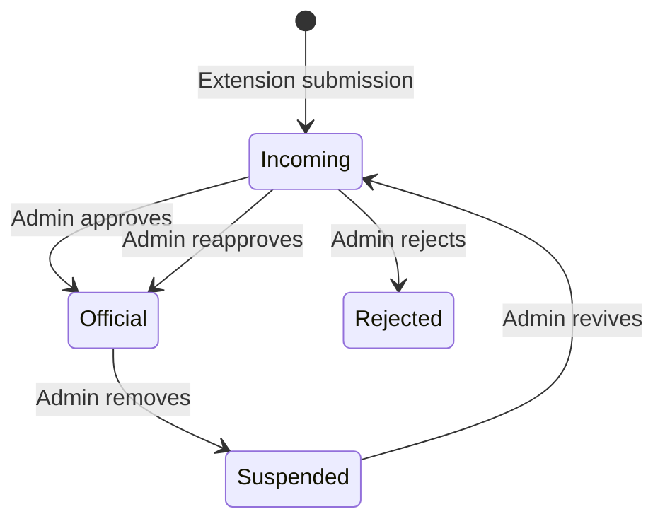

# FreeTV Content Lifecycle Mini Spec

**Status:** Early concept / future enhancement  
**Purpose:** Define the current direction for content intake, official content, health review, suspension, recovery, retirement, and eventual purge.

This document combines the former Incoming Hopper/Quarantine and deleted-show archive notes into one lifecycle model.  It records architectural direction and unresolved questions; it is not yet a database schema, API contract, UI specification, or scheduled implementation commitment.

FreeTV v3 is now live and provides the foundation on which this future work would be built:

- MariaDB is authoritative for managed content.
- Published JSON is a generated Viewer artifact.
- Admin CRUD and publication remain separate operations.
- Publication Undo restores artifact state, not database state.
- FreeTV Tooling manages validated data, builds, release packages, and production assembly.

---

## 1. Overview

FreeTV content has a lifecycle with two complementary ends:

1. **Incoming Hopper**
   - Brings new or replacement candidates toward the official library.

2. **Content Suspension and Recovery**
   - Moves deliberately removed content out of the official content tables without immediately destroying its metadata, history, or recovery value.

These workflows interact, but they should retain clear responsibilities.  The Hopper controls entry into Official content.  Suspension preserves outgoing content and can later create a recovery candidate in the Hopper.

The live FreeTV content model should remain curated and comparatively simple.  Intake, moderation, health findings, historical snapshots, and recovery state should not contaminate the official playlist tables unnecessarily.

---

## 2. Lifecycle Vocabulary

The following terms describe distinct concepts and should not be treated as synonyms.

### Incoming

A candidate record awaiting automated validation, enrichment, or Admin review.  Incoming content is not Official content and must not appear in published Viewer data.

### Official

Approved content managed in the authoritative live MariaDB tables and eligible for publication according to its active/disabled state.

### Disabled

A record that remains in the official content tables but is temporarily excluded from normal publication.  It may be repaired or reactivated through normal Admin editing.

### Problem Detected

A user report or automated health finding requiring review.  Detection alone should not silently disable, suspend, or destroy content.

### Suspended

Content deliberately removed from the official playlist tables and placed into **content stasis**.  Useful metadata, source history, reason, timestamps, and attribution are preserved so the item can be reviewed, recovered, retired, or eventually purged.

“Suspended” is the lifecycle term.  “Archive-first” describes the storage behavior used to preserve the outgoing record.

### Rejected

An Incoming candidate that failed automated validation or Admin review.  The rejection reason and retry policy should determine whether correction and resubmission are allowed.

### Retired

Suspended content deliberately classified as unlikely to return.  Retirement may prevent routine recovery attempts while still preserving historical evidence.

### Purged

Historical data or inactive assets permanently erased through an explicit retention/cleanup decision.  Purge is not the normal meaning of Remove, Suspend, or Retire.

---

## 3. Core State Model



This diagram describes the principal editorial transitions.  It intentionally omits secondary operational states such as uploading, automated validation, disabled, problem detected, publication pending, published, recovery in progress, retired, and purged.

The most important rules are:

> New or replacement content enters the Official library through the Incoming Hopper.

> Removing Official content creates a recoverable Suspended record rather than silently destroying its history.

> Returning Suspended content to Official status requires a new Hopper review rather than a blind database rollback.

---

## 4. Separation of Responsibilities

### Incoming Hopper

Responsible for:

- Candidate intake
- Enrichment
- Automated validation
- Duplicate detection
- Rejection and correction feedback
- Admin review
- Approval
- Promotion into Official content

### Official Content

Responsible for:

- Current playlists and playlist membership
- Managed show metadata
- Active/disabled status
- Publication eligibility
- The authoritative source used to generate Viewer artifacts

### Suspension and Recovery

Responsible for:

- Preserving outgoing content snapshots
- Recording removal reason, time, and administrator
- Preserving old Internet Archive identifiers and other source history
- Holding content outside the Official tables
- Supporting investigation, replacement discovery, recovery, retirement, or purge

### Publication

Responsible for:

- Comparing authoritative Official content with currently published artifacts
- Generating/removing Viewer JSON and configuration artifacts
- Preserving publication Undo state

Publication must not promote Incoming content, suspend Official records, recover Suspended records, or recreate authoritative database rows during Undo.

---

## 5. Incoming Hopper

### Purpose

The Incoming Hopper is a standalone intake and review system for candidate FreeTV content.  Adding something to the Hopper must not automatically modify Official content or published Viewer data.

The Hopper may safely contain:

- Incomplete candidates
- Malformed candidates
- Duplicates
- Rejected submissions
- Content awaiting metadata
- Content awaiting thumbnails
- Failed automated checks
- Recovery candidates created from Suspended content
- Experimental private-beta submissions

### Example New-Content Workflow

```text
Browse Internet Archive
      ↓
Find suitable content
      ↓
"Add to FreeTV"
      ↓
Incoming Hopper
      ↓
Automated validation and duplicate checks
      ↓
Pending Admin review
      ↓
Admin verifies or edits
      ↓
Approve
      ↓
Promote into Official MariaDB content
      ↓
Publish
      ↓
Viewer
```

The initial capture mechanism may be the planned browser extension.  Other intake methods can use the same Hopper contract later.

### Candidate Review Information

An administrator may need to review:

- Internet Archive identifier
- Title
- Description
- Playlist/category destination
- IMDb ID
- Start/end years
- Thumbnail
- Duplicate status across Official, Incoming, and Suspended content
- Source availability
- Automated validation results
- Contributor/submission provenance

The exact validation rules remain to be designed.

### Promotion Boundary

```text
Incoming record
      ≠
Official content record
```

Only an explicit approved promotion transaction should create the appropriate Official records.  Approval by the Admin does not publish Viewer artifacts automatically unless a future workflow deliberately and separately invokes publication.

### Rejection and Resubmission

Rejection reasons should be structured rather than represented only as free-form text.  Different reasons may have different retry policies.

Examples include:

- Invalid Internet Archive identifier — correctable
- Incomplete or incorrect metadata — correctable
- Duplicate Official content — blocked while the Official record exists
- Temporarily unavailable source — retry later
- Unsuitable content — identifier may be blocked from resubmission
- Spam or abuse — contributor/token enforcement may apply

Internal moderation notes should remain separate from contributor-facing feedback.

### Extension Submission Queue

The browser extension should maintain a visible local queue for Draft, Ready, Uploading, Rejected, Ready to Retry, Accepted, and Awaiting Review states.

Server acceptance means the payload passed intake validation and entered the Hopper.  It does not mean the candidate was approved or published.

A successful submission should return an unguessable receipt/status credential scoped only to that submission.  Authentication and public contributor accounts remain later design work.

---

## 6. Content Health Checking

A separate automated checker may periodically inspect Official content for unavailable Internet Archive identifiers, including `is_dark` findings.

The checker should identify potential problems rather than automatically deleting, suspending, or disabling content.

```text
Official Content
      ↓
Automated checker
      ↓
Problem detected
      ↓
Admin review
      ├─ Keep active
      ├─ Disable temporarily
      ├─ Replace identifier
      └─ Suspend
```

Manual checks, scheduled cron checks, retries, and future workers should share one rate-limiting/request-budget system.  Current Internet Archive guidance must be verified when implementation begins.

---

## 7. Suspension / Content Stasis

### Core Principle

An item removed from Official content should leave the live playlist tables but should not disappear without a historical record.

Conceptually:

```text
Official playlist membership
      ↓
Archive useful state
      ↓
Remove from Official tables
      ↓
Suspended content stasis
```

The eventual database table name is intentionally undecided.  Possible implementation names include:

```text
suspended_playlist_shows
archived_playlist_shows
content_stasis
```

The table design should follow the final identity and lifecycle model.  The earlier name `deleted_playlist_shows` should not be treated as settled architecture.

### Possible Preserved Fields

```text
id
original_playlist_show_id
original_playlist_id
show_id
identifier
title
category
description
start_year
end_year
imdb
status_at_suspension
sort_order
suspension_reason
suspended_by
suspended_at
retired_at
purged_at
created_at
updated_at
```

Snapshot fields should be retained where useful so the historical record remains meaningful even if related Official records later change or disappear.

The exact schema must be designed against the live `shows`, `playlists`, and `playlist_shows` relationships rather than copied directly from this list.

### Suspension Transaction

Suspending an individual playlist membership should occur inside one database transaction:

1. Resolve and lock the exact Official `playlist_shows` row.
2. Insert the preserved snapshot into the stasis/archive structure.
3. Remove the Official playlist-membership row.
4. Update `playlists.lastupdated` as required by the live contract.
5. Commit.

If preservation or removal fails, the complete operation must roll back.

The operation must not directly modify published Viewer JSON.  Publication remains a separate action.

### Suspension Reasons

Possible controlled reasons include:

```text
no_replacement
duplicate
incorrect_entry
copyright_or_policy
source_unavailable
editorial_removal
other
```

An Internet Archive `is_dark` result should not automatically suspend an item.  The result applies to a specific identifier, and another usable upload may exist.

### Disabled Versus Suspended

```text
Disabled
- Remains in Official content tables
- Temporarily excluded from publication
- May be repaired/reactivated through normal editing

Suspended
- Removed from Official content tables
- Preserved in content stasis
- Requires deliberate Hopper review before returning
```

Bulk suspension of every disabled item should not be assumed safe.

---

## 8. Recovery Through the Hopper

Suspended content should not be restored by recreating its former row or database ID blindly.

```text
Suspended content
      ↓
Replacement or revival requested
      ↓
Create Incoming recovery candidate
      ↓
Reuse appropriate preserved metadata
      ↓
Validate source and duplicates
      ↓
Admin review
      ↓
Approve
      ↓
Create new Official records
      ↓
Publish
```

This handles cases where:

- The original Internet Archive identifier is dead
- A replacement upload has been found
- Playlist structure has changed
- Metadata has been corrected
- The old sort position is no longer appropriate
- The title belongs in a different playlist
- Equivalent Official or Incoming content already exists

The Suspended record becomes source material for a new editorial review, not an instruction to reconstruct old state exactly.

### Preserve Source History

Recovery should preserve lineage:

```text
Original Official record
      ↓
Old identifier failed or content removed
      ↓
Suspended
      ↓
Recovery candidate created
      ↓
Replacement validated
      ↓
New Official record
```

The previous Internet Archive identifier, suspension reason, relevant decisions, and new Official identity should remain auditable.  The exact audit/history model remains to be designed.

---

## 9. Thumbnail and Asset Lifecycle

Thumbnails are stored by IMDb ID:

```text
/thumbs/<imdb>.jpg
```

One physical thumbnail may serve multiple shows or playlist memberships.  Suspending one membership must not automatically delete or move a shared thumbnail.

### Active-Reference Check

After an Official playlist membership is suspended, the system may determine whether any remaining Official records reference the same IMDb ID.

```text
Suspend playlist membership
      ↓
Check Official references to IMDb ID
      ├─ References remain
      │      Leave /thumbs/<imdb>.jpg unchanged
      └─ No references remain
             Thumbnail becomes an orphan candidate
```

Automatic asset movement is intentionally outside the first suspension implementation.

### Orphan Directory

A later phase may move an unreferenced thumbnail rather than deleting it:

```text
/thumbs/<imdb>.jpg
      ↓
/orphans/<imdb>.jpg
```

The move preserves reusable artwork while keeping the active thumbnail directory aligned with Official content.

### Recovery Lookup

```text
Incoming or recovery IMDb ID
      ↓
Does /thumbs/<imdb>.jpg exist?
      ├─ Yes → Reuse active thumbnail
      └─ No
          ↓
Does /orphans/<imdb>.jpg exist?
      ├─ Yes → Offer recovery into /thumbs
      └─ No  → Require a thumbnail
```

Recovering an orphaned thumbnail must not itself restore Suspended content.  The Hopper review remains mandatory.

### Retention and Purge

Orphaned thumbnails may eventually become eligible for permanent deletion after a configurable retention period.  Before purging an orphan, cleanup tooling must recheck all active references and consider the final policy for Suspended/Retired content.

Permanent deletion must be an explicit cleanup operation, not a side effect of suspension.

### Thumbnail Replacement Is Different

Replacing the canonical image for an actively referenced IMDb ID should not create an orphan copy of the old image.  Replacement should validate the image, count active/shared references, warn the administrator, and require explicit confirmation before overwrite.

### Future Integrity Reports

Maintenance tooling may eventually report:

- Official IMDb IDs with missing thumbnails
- Active thumbnails with no Official database references
- Orphan files that became active again
- Orphans eligible for purge
- Suspended/Retired content with recoverable thumbnails
- Duplicate or unexpected files
- Filesystem/database inconsistencies

MariaDB remains authoritative for determining content references.  The filesystem must not independently decide whether content exists.

---

## 10. Playlist Deletion

Deleting an individual playlist membership and deleting an entire playlist are separate operations.

A playlist should not be eligible for removal while it contains Official playlist memberships:

```text
Playlist contains Official items
      ↓
Playlist removal prohibited
      ↓
Admin suspends/reassigns items deliberately
      ↓
Playlist becomes empty
      ↓
Playlist may be removed
```

The current default playlist must not be removed until another playlist has been made default.  Playlist removal must never cascade-suspend or cascade-delete Official memberships implicitly.

A future playlist archive/stasis structure may preserve removed playlist metadata.  Reintroduction should create a new live playlist identity rather than reclaiming the former database ID.

---

## 11. Relationship to Publication and Undo

Admin lifecycle changes and Viewer publication remain separate.

Suspending an Official item or removing an eligible empty playlist changes MariaDB state but does not directly rewrite the currently published Viewer artifacts.

```text
Official content changes
      ↓
Publish detects pending differences
      ↓
Viewer artifacts are generated or removed
```

Publication Undo restores only the previous artifact state.  It must not recreate Suspended content, reverse Admin decisions, or restore removed database identities.

```text
CREATE:
Official record added → Publish creates artifact state → Undo restores prior artifacts

REMOVE:
Official record suspended/removed → Publish removes artifact state → Undo restores prior artifacts
```

In neither direction does publication Undo alter the authoritative lifecycle state in MariaDB.

---

## 12. Admin Experience

The complete GUI remains future design work.  It will likely require distinct operational areas.

### Incoming Queue

- Candidate list with age, source, validation status, duplicate signals, and provenance
- Review workspace with editable metadata and thumbnail preview
- Approve, reject, request correction, defer, and mark-abuse decisions
- Structured decision reasons and retry policies

### Suspended Content

- Search and filters by title, identifier, IMDb ID, playlist, reason, and date
- Preserved metadata and source history
- Retirement and purge eligibility where permitted
- Create Recovery Candidate action

### Problems

- Combined user-submitted and system-detected findings where useful
- Clear distinction between a finding and a lifecycle transition
- Actions to keep, disable, edit, replace, or suspend

### Activity and Audit History

- Who acted
- What decision was made
- Which records were affected
- When it happened
- What changed
- How an old identity relates to a new Official record after recovery

The Admin workflow and decision reason catalog should be designed before database states and endpoints are finalized.

---

## 13. Cleanup and Maintenance Possibilities

Future lifecycle tooling may include:

- Finding replacement Internet Archive uploads
- Automated rechecking of Suspended identifiers
- Reporting suspension and retirement counts/reasons
- Reviewing lifecycle actions by date range or administrator
- Detecting Official content that duplicates Incoming or Suspended content
- Finding reusable metadata and thumbnails
- Moving genuinely unreferenced assets to `/orphans/`
- Purging eligible Retired records or orphaned assets after explicit retention rules

Cleanup tooling must distinguish Official references, Suspended/Retired historical value, and filesystem state before moving or deleting anything.

---

## 14. Suggested Implementation Phases

### Phase 1: Suspension Foundation

- Finalize terminology and identity rules
- Design the stasis/archive schema
- Implement transactional suspension for one playlist membership
- Preserve timestamp, reason, source identity, and useful snapshot metadata
- Keep publication separate
- Add focused integration tests

### Phase 2: Reference and Asset Awareness

- Add cross-playlist/content reference checks
- Add active-thumbnail reference detection
- Report orphan candidates
- Defer automatic movement until reporting is verified

### Phase 3: Health Findings and Suspended Admin UI

- Add rate-limited manual/scheduled health checks
- Integrate findings with the Problems workflow
- Add Suspended-content search and review
- Define retirement and retention policies

### Phase 4: Incoming Hopper

- Finalize candidate identity and duplicate rules
- Define validation, rejection, retry, and promotion contracts
- Build the Admin intake/review workflow
- Keep the initial submission path private

### Phase 5: Recovery and Asset Reuse

- Create Hopper recovery candidates from Suspended content
- Preserve lineage from old to new identifiers
- Reuse active or orphaned thumbnails safely
- Add appropriate audit history

### Phase 6: Browser Extension Integration

- Finalize a versioned submission API
- Implement the extension submission queue and status receipts
- Add contributor authentication only when real usage requires it

### Phase 7: Retention and Purge

- Add explicit retention rules
- Implement dry-run cleanup reporting
- Purge only records/assets proven eligible
- Preserve audit requirements defined by policy

---

## 15. Initial Scope Boundary

The first active implementation should include only the Suspension Foundation described above.

It should not initially include:

- Direct restoration
- Incoming Hopper implementation
- Browser-extension submission
- Bulk suspension
- Automatic suspension based on `is_dark`
- Automatic replacement searches
- Automatic thumbnail movement
- Permanent record or asset purge
- Public contributor accounts
- Changes that couple Admin suspension directly to publication

At no point should suspending one playlist membership blindly move or delete a thumbnail used elsewhere.

---

## 16. Unresolved Design Questions

Before implementation, decide:

- What constitutes the same content identity across Internet Archive uploads and playlists?
- Is Suspension stored as copied snapshots, lifecycle events, retained content identities, or a combination?
- Which fields belong to shared show identity versus playlist membership?
- Can one Suspension action affect all playlist instances, or must every membership be explicit?
- What are the exact suspension, rejection, retirement, and purge reason catalogs?
- Which rejection reasons permit corrected resubmission?
- How are problem reports related to Suspended content after Official rows are removed?
- How long are Suspended and Retired records retained?
- When, if ever, are inactive thumbnails moved automatically?
- What information may contributors see about Admin decisions?
- What audit attribution is required before Suspension ships?
- What transaction guarantees promotion from Incoming to Official content?

---

## 17. Out of Scope for This Mini Spec

This document does not yet finalize:

- Database schemas or table names
- API endpoints or payload formats
- Exact UI layouts
- Browser-extension implementation
- Authentication/account architecture
- Automated scheduling details
- Moderation reputation systems
- Replacement matching algorithms
- Audit-log schema
- Deployment architecture
- Retention durations

Those decisions should be made during the design phase for each implementation milestone.

---

## 18. Current Priority

Do not implement the full lifecycle system yet.

The current roadmap prioritizes post-v3 production hardening, runtime cleanup, dependency maintenance, repeatable development state, containerization, and the automated-test foundation before the Incoming Hopper and browser-extension integration.

When lifecycle work becomes active, begin with the narrowly bounded Suspension Foundation rather than attempting Intake, health automation, recovery, asset cleanup, and public submissions simultaneously.

---

## 19. Summary

FreeTV content should not be treated as simply present or deleted.

- **Incoming** content is reviewed before entering the Official library.
- **Official** content remains the only source for publication.
- **Disabled** content stays Official but is temporarily excluded.
- **Suspended** content leaves the Official tables but remains preserved in stasis.
- **Recovery** returns through the Incoming Hopper and requires reapproval.
- **Retired** content remains historical but is not expected to return routinely.
- **Purge** is an explicit final cleanup action.

Together, the Incoming Hopper and Content Suspension/Recovery systems create a controlled, reversible, and auditable lifecycle around the curated FreeTV library.
